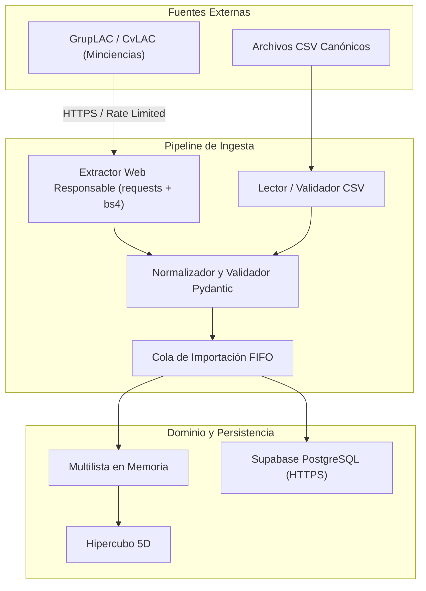

# Ingesta de Datos: Extracción Web SCIENTI e Importación de Archivos

## 1. Principio y Vías de Entrada

La ingesta de datos en PEA-i proporciona la información de grupos, investigadores y productos requerida para el análisis. Se contemplan dos canales oficiales de alimentación:
- **Vía A (Extracción Web SCIENTI)**: Descarga directa desde los portales oficiales GrupLAC y CvLAC de Minciencias.
- **Vía B (Archivos Tabulares Canónicos)**: Importación estructurada mediante archivos CSV o exportaciones estandarizadas.



## 2. Vía A: Extracción Web Responsable (SCIENTI)

El scraping web está sujeto a las reglas estrictas de [[ADR-0010-Limites-y-responsabilidad-de-ingesta]]:
1. **Dominios Permitidos**: Exclusivamente `scienti.minciencias.gov.co`. Cualquier intento hacia otros dominios se bloquea.
2. **Protocolo Seguro**: Conexiones forzadas por `HTTPS`.
3. **Identificación Institucional (User-Agent)**:
   ```http
   User-Agent: PEA-i/1.0 (Universidad Popular del Cesar; Taller Estructura de Datos; contacto@unicesar.edu.co)
   ```
4. **Respeto al Servidor y Pausas**:
   - Pausa obligatoria mínima de **1.0 segundo** entre peticiones sucesivas.
   - Máximo **3 reintentos** automáticos ante fallos 5xx con retroceso exponencial (*exponential backoff*: 2s, 4s, 8s).
   - Tiempo de espera máximo (*timeout*) de 15 segundos por solicitud.
5. **Caché Local de Respuestas**:
   - Todo documento HTML extraído se almacena en `datos/cache/<hash_url>.html` junto a sus metadatos HTTP en JSON.
   - Si la caché es válida (vigencia configurable, por defecto 24 horas), no se reitera la petición de red.
6. **Resiliencia ante Fallos**:
   - Si Minciencias cambia su estructura HTML o el servicio está fuera de línea, la aplicación no colapsa: atrapa el error, informa al usuario con un mensaje claro y propone como alternativa la carga vía archivo CSV.

### 2.1. Importación por lote de grupos

La CLI acepta `importar-url --archivo-grupos datos/fuentes/grupos_upc.txt`. El archivo UTF-8 contiene un código GrupLAC por línea; se omiten líneas vacías y comentarios iniciados con `#`, y se descartan duplicados. Cada código se valida como una secuencia de dígitos antes de construir la URL oficial de GrupLAC. Las tareas se encolan y procesan secuencialmente con una única instancia de `ServicioIngesta` y `ExtractorURL`, por lo que se conservan la pausa mínima entre solicitudes, los reintentos, la caché y la validación de host y HTTPS descritos arriba. Los resultados de cada grupo se guardan en su propio subdirectorio. No se incluyen códigos de grupos en el repositorio; deben proceder de una fuente autorizada.

El año de los productos se extrae de la posición bibliográfica de la fecha, no
del primer número de cuatro cifras (que puede ser parte de un ISSN o DOI). Si
la fuente no ofrece un año dentro del rango permitido, el producto no se
agrega al catálogo, se informa como advertencia y la exportación deja el año
vacío; nunca se sustituye por un año predeterminado.

La importación GrupLAC conserva en `grupos.detalles` las secciones completas
extraídas (instituciones, líneas, integrantes y productos), además de crear
productos e integrantes relacionados cuando la fuente publica un código CvLAC
numérico verificable. Cada perfil enlazado se agrega a la cola como una tarea
CvLAC independiente; así puede procesarse en orden y conserva la pausa mínima
entre peticiones. También se admite pegar directamente una URL CvLAC. Los
perfiles y sus secciones de formación y productos se conservan en
`investigadores.detalles`, y los productos con año válido se registran en sus
tablas de dominio. Para los grupos nuevos, `fecha_creacion` se deriva del
año y mes de formación; si la fuente no lo informa, se usa la fecha de ingesta
para cumplir el esquema obligatorio. Los listados Supabase se solicitan por
rangos paginados; las tablas Python muestran 50 filas por página y la TUI C++
presenta 12 registros por página, navegables con `[` y `]`. La revisión global
de la base aumenta una sola vez por transacción, incluso si un RPC inserta un
producto y sus relaciones en varias tablas. La importación directa por URL de
ambas CLI procesa la cola de perfiles CvLAC asociada antes de finalizar; en la
interfaz Python la acción **Procesar todas** realiza ese procesamiento
secuencial respetando la pausa entre solicitudes. Si se detecta una edición
externa al crear productos, ambos clientes actualizan la revisión y reintentan la
operación hasta tres veces con espera incremental. La revisión se bloquea dentro
del RPC para serializar validación y escritura concurrentes. Si el conflicto
persiste, la cola se detiene para no continuar con una revisión desactualizada;
hay que recargar y volver a encolar la tarea interrumpida. Las consultas de C++
mantienen los filtros al solicitar cada rango.

## 3. Vía B: Importación por Archivos Tabulares (CSV)

Para contingencias sin conexión o migraciones masivas, PEA-i define un formato canónico de 4 archivos CSV (codificados en UTF-8 sin BOM, delimitador por coma `,` y comillas dobles para texto):

### 3.1. `grupos.csv`
```csv
codigo_minciencias,nombre,clasificacion,institucion
COL0008543,Grupo de Investigación en Tecnologías de Información,A1,Universidad Popular del Cesar
```

### 3.2. `investigadores.csv`
```csv
codigo_cvlac,nombre_completo,categoria,nacionalidad
0000494917,Pérez Juan Carlos,Investigador Senior (IS),Colombia
```

### 3.3. `productos.csv`
```csv
codigo_identificador,titulo,tipo_mayor,subtipo,anio,estado_validacion,grupo_codigo
ART-2023-001,Análisis de Grafos en Redes Complejas,GNC,Artículo Tipo A1,2023,Avalado,COL0008543
```

### 3.4. `autores.csv`
```csv
producto_codigo,investigador_codigo,orden_autoria
ART-2023-001,0000494917,1
```

### 3.5. Alias y campos opcionales

Los encabezados se comparan sin distinguir mayúsculas y minúsculas. Se aceptan
estos nombres equivalentes:

| Archivo | Nombre canónico | Alias admitido |
|---|---|---|
| Grupos | `codigo_minciencias` | `codigo_gruplac` |
| Grupos | `nombre` | `nombre_grupo` |
| Grupos | `clasificacion` | `categoria` |
| Grupos | `institucion` | `institucion_principal` |
| Investigadores | `codigo_cvlac` | `codigo_rh` |
| Investigadores | `nombre_completo` | `nombre` |
| Investigadores | `categoria` | `categoria_declarada` |
| Investigadores | `formacion_academica` | `formacion` |
| Productos | `tipo_mayor` | `tipo_categoria` (encabezado legado; conversión documentada abajo) |
| Productos | `anio` | `ano` |
| Productos | `grupo_codigo` | `codigo_gruplac` |

Además de los campos de los ejemplos, grupos admiten `lider`, `pais`,
`departamento_ciudad`, `gran_area_ocde`, `area_ocde`, `activo` y `es_ejemplo`;
investigadores admiten `formacion_academica`, `nombre_en_citas`,
`documento_identidad`, `sexo`, `activo` y `es_ejemplo`; productos admiten
`subtipo`, `mes`, `pais`, `activo`, `es_ejemplo` y `detalles`. El campo
`detalles` de productos, si se incluye, debe ser un objeto JSON y se conserva
en `PRODUCTO.detalles`.

Para campos booleanos se reconocen `true`/`false`, `1`/`0`, `yes`/`no`,
`y`/`n`, `t`/`f`, `on`/`off` y `si`/`sí` (también en mayúsculas). Un valor
vacío usa el valor predeterminado del modelo (`activo=true`,
`es_ejemplo=false`). `orden_autoria` se interpreta como entero; si la columna
no está presente se usa `1`, pero un valor vacío o no numérico se informa como
error de fila.

El encabezado legado `tipo_categoria` contiene una etiqueta de producto, no
necesariamente el código de `tipo_mayor`. De acuerdo con RF-04 de [[SPEC]] y
el catálogo de [[Modelo-Productos]], los lectores reconocen etiquetas de
artículos A1, A2, B y C, libros y capítulos resultado de investigación,
patentes de invención, productos DTI, productos ASC y productos FRH. Por
ejemplo, `Artículo Tipo A1` se asigna a `GNC`; si no se proporciona `subtipo`,
la etiqueta original se conserva allí. Los códigos explícitos `GNC`, `DTI`,
`ASC` y `FRH` también se aceptan. La comparación ignora mayúsculas, tildes y
espacios redundantes.

Esta interpretación del encabezado legado no está definida directamente por
el Modelo, así que se registra como supuesto de compatibilidad en
[[ADR-0022-Interpretacion-categoria-legada-csv]]. Si se informan
simultáneamente `tipo_categoria` y `tipo_mayor`, ambos deben corresponder a la
misma tipología; una categoría no reconocida o contradictoria produce un
error de fila. Un `subtipo` explícito se conserva sin reemplazarlo.

## 4. Normalización, Detección de Duplicados y Desduplicación

Antes de que un elemento ingrese en la [[Cola-importacion]], se aplican las siguientes reglas:
1. **Limpieza de Cadenas**: Eliminación de espacios redundantes, normalización Unicode NFC, sustitución de caracteres invisibles o saltos de línea huérfanos.
2. **Detección de Duplicados**:
   - Para Grupos: Por `codigo_minciencias`.
   - Para Investigadores: Por `codigo_cvlac`.
   - Para Productos: Por identificador natural normalizado (`DOI` o combinación `titulo_normalizado + anio`).
3. **Resolución de Conflictos**:
   - Si el registro ya existe en la [[Multilista]], no se duplica el nodo: se actualizan sus metadatos más recientes y se enlazan los nuevos autores si no estaban acreditados.
   - Cada inserción genera el evento correspondiente para encolar la persistencia y notificar a la GUI.
