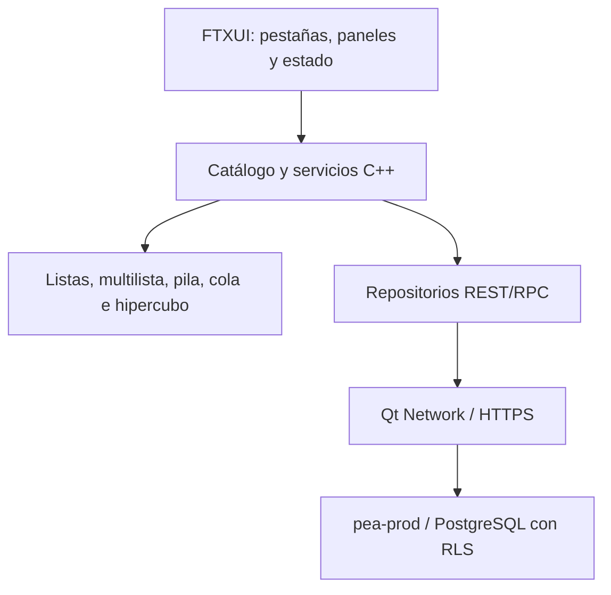

# Diseño · Terminal C++ de PEA-i

## Propósito

Registrar la estructura y los criterios de aceptación de la interfaz C++ de
terminal. La GUI de Python continúa siendo una aplicación distinta; la TUI no
presenta datos personales ficticios ni declara paridad funcional hasta que las
operaciones estén implementadas y verificadas.

## Diseño

La navegación inicial contiene Inicio, Investigadores, Grupos, Productos,
Análisis de redes, Importar, Configuración y Acerca de. Las teclas `1`–`8`,
flechas, `q` y Escape cambian de sección o terminan la aplicación. Los
directorios muestran hasta doce filas del catálogo en memoria. `--demo` carga
entidades sintéticas prefijadas `PRUEBA-`, exclusivamente en memoria.
En Investigadores, Grupos y Productos, `/` activa una búsqueda textual sin
distinguir mayúsculas; Enter la conserva, Escape borra el filtro y retroceso
edita la consulta.

La autoprueba crea pantallas de 80×24, 100×28, 120×35 y 160×50, revisa ancho de
celdas Unicode, caracteres de reemplazo, pestañas y título visible de cada
vista, y escribe capturas de texto sin color en `datos/capturas/terminal/`.
En Inicio adapta las tarjetas KPI a dos filas cuando el ancho es menor de 100
columnas; en 80×24 prioriza las cuatro tarjetas y omite el resumen tabular
secundario.

## Componentes y estado actual

| Componente | Estado comprobado |
|---|---|
| Barra de pestañas y navegación por teclas | Implementada |
| Resumen institucional y directorios de lectura | Implementados |
| Búsqueda textual en investigadores, grupos y productos | Implementada sobre los campos de cada entidad; admite `campo:valor` con nombres canónicos de datos |
| Insignia de demo/Supabase/sin datos y mensaje de conexión | Implementada |
| Carga remota al inicio con configuración disponible | Implementada; requiere pruebas de red autenticadas |
| Capturas de autoprueba | 32 archivos generados por `--autoprueba` |
| Formularios para crear, editar metadatos, activar/desactivar y eliminar; confirmación `ELIMINAR` | Implementados para las tres entidades; formularios verificados por autoprueba de renderizado |
| Ficha JSON de grupo, investigador y producto | Implementada; la ficha de producto incluye grupo y autores enlazados |
| Análisis institucional anual y pares frecuentes de coautoría | Implementado desde el catálogo cargado y las relaciones de la multilista; requiere comparación diferencial con Python |
| Importar CSV (grupos, investigadores, productos o autores) | Implementado desde la pestaña Importar; valida tipo y requiere conexión autenticada |
| Importar URL SCIENTI (GrupLAC/CvLAC) | Implementado desde la pestaña Importar; restringido por el extractor al host autorizado y requiere definir anonimización |
| Filtros temporales de estadísticas: todos, últimos cinco años, rango y Modelo 2024 | Implementados en Análisis de redes con `f` y `g`; los rangos se calculan sobre el hipercubo |
| Filtros por campos en los directorios | Implementados con la sintaxis `campo:valor`; la comparación del nombre del campo no distingue mayúsculas |
| Modales de confirmación accesibles | Pendientes; la eliminación usa un campo de confirmación textual |
| Inicio compacto a 80×24 | Implementado; otras vistas aún requieren revisión visual |
| Marcos ASCII `+ - |` | Implementados y comprobados por `--autoprueba`; temas claro/alto contraste pendientes |
| Revisión de versión remota | Implementada cada 30 segundos en un hilo con cliente HTTPS independiente; los eventos se aplican en el hilo TUI. Los fallos se muestran explícitamente y no se sustituyen por la revisión local |
| Operaciones de red asíncronas | Pendientes para la ingesta interactiva; las consultas periódicas ya son asíncronas |

## Criterios de aceptación

- La salida debe ser UTF-8 y no revelar credenciales.
- La interfaz distingue los datos remotos de los datos de demostración y del
  estado sin datos.
- No se ejecutan escrituras desde un catálogo desconectado.
- La autoprueba termina con código cero solo cuando las 32 pantallas se
  renderizan, se guardan, muestran las ocho pestañas y el título de la vista,
  y no exceden el ancho de su `Screen`; en Inicio a 80×24 también deben verse
  las cuatro etiquetas KPI. Se comprueba además una búsqueda insensible a
  mayúsculas y filtros por atributos en los tres directorios con entidades de
  demostración, el renderizado de los quince formularios de gestión y una red
  con coautoría.
- Las vistas y las operaciones pendientes deben marcarse como tales; un
  marcador de posición no cuenta como funcionalidad.

## Decisiones relacionadas

- [[ADR-0019-Cpp-terminal-con-ftxui]]
- [[GUI-paridad]]
- [[Paridad-Python-Cpp]]

## Riesgos y casos borde

- La lectura de Supabase requiere una sesión y políticas RLS adecuadas; no se
  valida con una clave privilegiada.
- La autoprueba valida renderizado, no el flujo de eventos del teclado ni la
  persistencia de CRUD; estos requieren pruebas de integración adicionales.
- La ingesta interactiva se ejecuta en el hilo de la TUI; solicitudes lentas de
  red pueden demorar su respuesta. Se requiere extraer el trabajo a una tarea
  asíncrona que no comparta estructuras mutables con el hilo de interfaz.
- La consulta periódica usa el token de acceso copiado al iniciar el trabajador;
  no renueva sesiones. Si el token expira, el error se muestra y la consulta
  siguiente vuelve a intentarlo. El trabajador se detiene y se une al cerrar
  la TUI; una solicitud en curso puede demorar el cierre hasta el timeout HTTP.
- La prueba de tamaño no sustituye snapshots revisados ni comprueba todos los
  casos de truncamiento.
- La búsqueda se realiza sobre los campos del catálogo ya cargado; no reemplaza
  una búsqueda remota paginada.
- El filtro del Modelo 2024 sigue las ventanas que implementa el servicio:
  corte 2023, 5 años generales y extensión a 10 años para libros, patentes y
  variedades; las coautorías se restringen a esos mismos límites.
