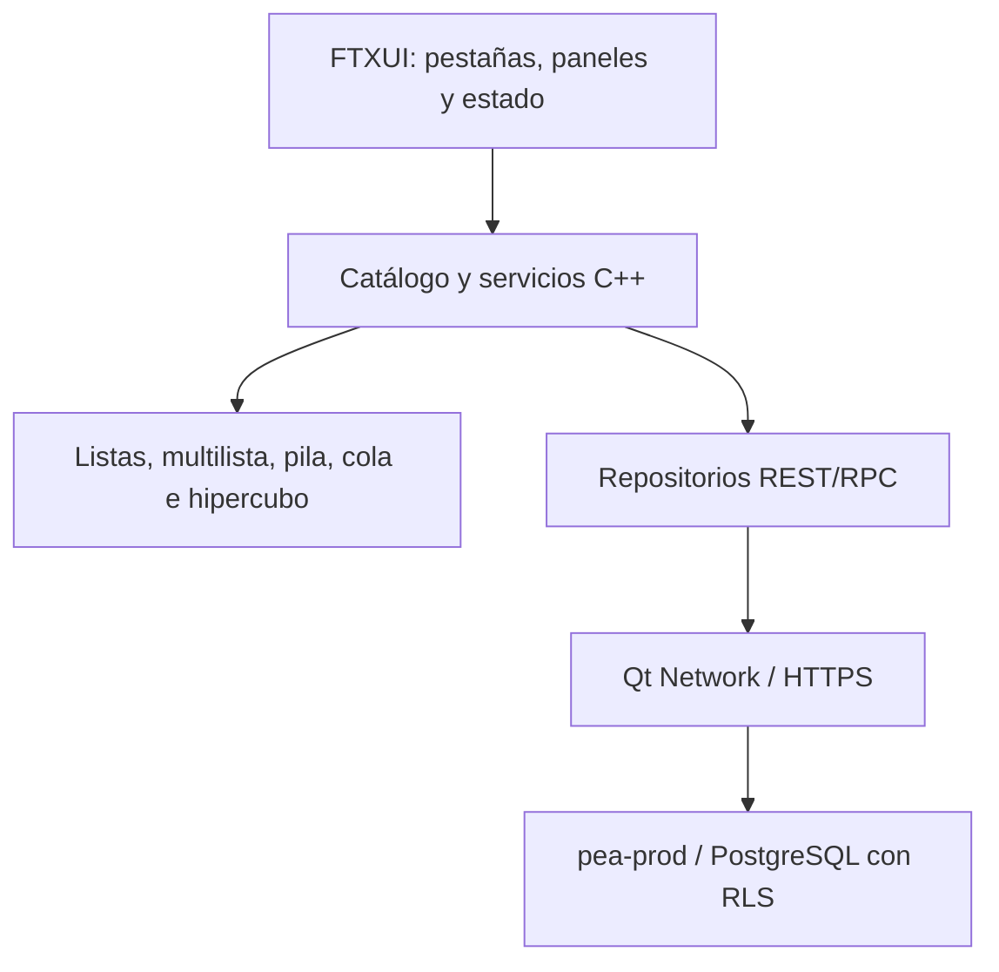

# Diseño · Terminal C++ de PEA-i

## Propósito

Registrar la estructura y los criterios de aceptación de la interfaz C++ de
terminal. La GUI de Python continúa siendo una aplicación distinta; la TUI no
presenta datos personales ficticios ni declara paridad funcional hasta que las
operaciones estén implementadas y verificadas.

## Diseño

La navegación inicial contiene Inicio, Investigadores, Grupos, Productos,
Análisis de redes, Importar, Configuración y Acerca de. Las teclas `1`–`8`,
flechas, `q` y Escape cambian de sección o terminan la aplicación. Los
directorios muestran hasta doce filas del catálogo en memoria. `--demo` carga
entidades sintéticas prefijadas `PRUEBA-`, exclusivamente en memoria.
En Investigadores, Grupos y Productos, `/` activa una búsqueda textual sin
distinguir mayúsculas; Enter la conserva, Escape borra el filtro y retroceso
edita la consulta.

La autoprueba crea pantallas de 80×24, 100×28, 120×35 y 160×50, revisa ancho de
celdas Unicode, caracteres de reemplazo, pestañas y título visible de cada
vista, y escribe capturas de texto sin color en `datos/capturas/terminal/`.
En Inicio adapta las tarjetas KPI a dos filas cuando el ancho es menor de 100
columnas; en 80×24 prioriza las cuatro tarjetas y omite el resumen tabular
secundario.

## Componentes y estado actual

| Componente | Estado comprobado |
|---|---|
| Barra de pestañas y navegación por teclas | Implementada |
| Resumen institucional y directorios de lectura | Implementados |
| Búsqueda textual en investigadores, grupos y productos | Implementada; búsqueda sobre campos visibles |
| Insignia de demo/Supabase/sin datos y mensaje de conexión | Implementada |
| Carga remota al inicio con configuración disponible | Implementada; requiere pruebas de red autenticadas |
| Capturas de autoprueba | 32 archivos generados por `--autoprueba` |
| Formularios CRUD, ficha, modales y búsqueda | Pendientes |
| Gráficos, red de coautoría y filtros interactivos | Pendientes |
| Inicio compacto a 80×24 | Implementado; otras vistas aún requieren revisión visual |
| Tema claro/alto contraste y marcos ASCII `+ - |` | Pendientes |
| Revisión periódica en segundo plano y operaciones de red asíncronas | Pendientes |

## Criterios de aceptación

- La salida debe ser UTF-8 y no revelar credenciales.
- La interfaz distingue los datos remotos de los datos de demostración y del
  estado sin datos.
- No se ejecutan escrituras desde un catálogo desconectado.
- La autoprueba termina con código cero solo cuando las 32 pantallas se
  renderizan, se guardan, muestran las ocho pestañas y el título de la vista,
  y no exceden el ancho de su `Screen`; en Inicio a 80×24 también deben verse
  las cuatro etiquetas KPI. Se comprueba además una búsqueda sensible a
  mayúsculas en los tres directorios con entidades de demostración.
- Las vistas y las operaciones pendientes deben marcarse como tales; un
  marcador de posición no cuenta como funcionalidad.

## Decisiones relacionadas

- [[ADR-0019-Cpp-terminal-con-ftxui]]
- [[GUI-paridad]]
- [[Paridad-Python-Cpp]]

## Riesgos y casos borde

- La lectura de Supabase requiere una sesión y políticas RLS adecuadas; no se
  valida con una clave privilegiada.
- FTXUI dibuja bordes Unicode; el modo ASCII requiere completar un marco con
  caracteres `+`, `-` y `|`.
- La prueba de tamaño no sustituye snapshots revisados ni comprueba todos los
  casos de truncamiento.
- El filtro es temporal y solo busca en el texto mostrado; no reemplaza filtros
  por campos ni una búsqueda remota paginada.
